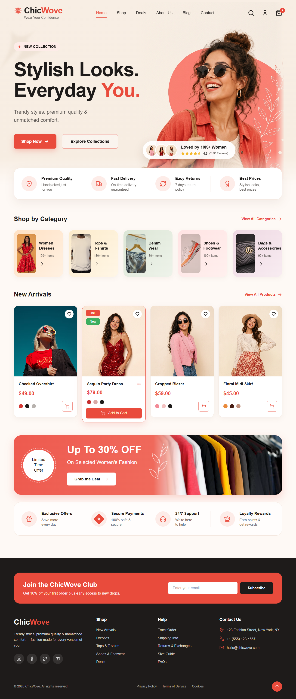
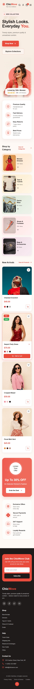
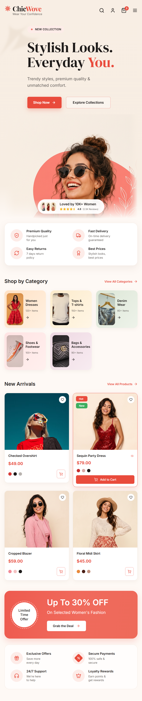
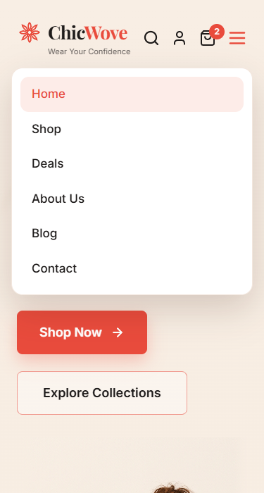
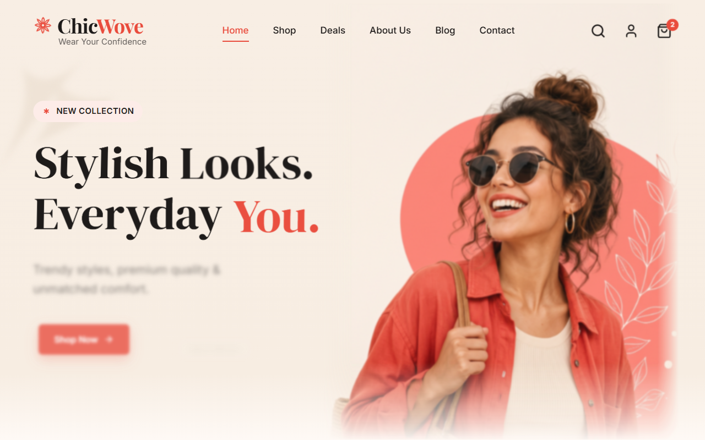
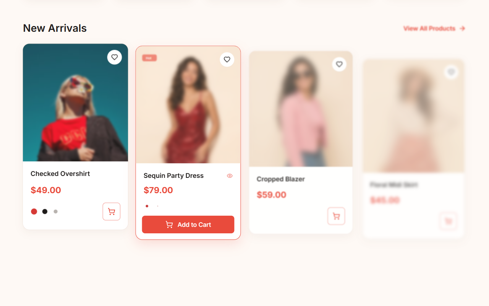

<div align="center">

# 👗 ChicWove — Fashion E-commerce Landing Page

**Wear Your Confidence.** A modern, fully responsive, animation-rich landing page for a women's fashion store.

[](https://saidur289.github.io/create-e-commerce-landing-page/)
[](https://github.com/Saidur289/create-e-commerce-landing-page/actions/workflows/deploy.yml)




</div>

---

## 📖 Table of Contents

- [About](#-about)
- [Features](#-features)
- [Tech Stack](#-tech-stack)
- [Live Demo](#-live-demo)
- [Getting Started](#-getting-started)
- [Project Structure](#-project-structure)
- [Animations](#-animations)
- [Responsive Design](#-responsive-design)
- [Screenshots](#-screenshots)
- [Visual Testing with Puppeteer](#-visual-testing-with-puppeteer)
- [Deployment](#-deployment)
- [Customization](#-customization)
- [Browser Support](#-browser-support)
- [Credits](#-credits)
- [License](#-license)

---

## 🧭 About

ChicWove is a single-page landing site recreated from the design mockup `Modern Fashion eCommerce Website Design.jpg`. It is a **self-contained `index.html`** — no build step, no bundler — that loads its libraries from CDNs and runs straight from the file system or any static host.

## ✨ Features

- 🎨 **Pixel-faithful replica** of the original design, with colours sampled directly from the mockup
- 📱 **Fully responsive** — tested from 320 px phones to 1920 px desktops, with no horizontal scroll
- 🍔 **Mobile / tablet menu** with a spring-animated dropdown
- 🌫️ **Blur-to-clear reveals** (`filter: blur()`) on load and on scroll
- 🏀 **Bouncy spring motion** using GSAP `back.out` and `elastic.out` eases
- 🧈 **Buttery smooth scrolling** with Lenis, synced to ScrollTrigger
- 🛒 **Micro-interactions** — animated add-to-cart counter, wishlist hearts, hover lifts and springy buttons
- 📨 **Footer** with newsletter sign-up, link columns, contact info, social links and back-to-top
- ♿ **Accessible by default** — semantic HTML, ARIA labels, and `prefers-reduced-motion` support
- 🛟 **Graceful fallback** — content stays visible if JavaScript or a CDN fails to load

## 🛠 Tech Stack

| Technology | Purpose |
| --- | --- |
| **HTML5** | Semantic page structure |
| **[Tailwind CSS](https://tailwindcss.com/) 3.4 (Play CDN)** | Utility-first styling and responsive breakpoints |
| **[GSAP](https://gsap.com/) 3.12 + ScrollTrigger** | Timeline and scroll-driven animations |
| **[Lenis](https://lenis.darkroom.engineering/) 1.1** | Smooth scrolling |
| **[Lucide](https://lucide.dev/) 0.453** | Lightweight SVG icon set |
| **Arial** | Typography across the whole page |
| **[Puppeteer](https://pptr.dev/)** | Headless-Chrome screenshots and automated visual checks |

## 🌐 Live Demo

👉 **https://saidur289.github.io/create-e-commerce-landing-page/**

## 🚀 Getting Started

### Prerequisites

- Any modern web browser
- *(Optional)* [Node.js](https://nodejs.org/) 18+ for the Puppeteer screenshot scripts

### Run locally

```bash
git clone https://github.com/Saidur289/create-e-commerce-landing-page.git
cd create-e-commerce-landing-page
```

Then open `index.html` in your browser — that's it. To serve it over HTTP instead:

```bash
npx serve .
```

## 📁 Project Structure

```
create-e-commerce-landing-page/
├── .github/workflows/deploy.yml   # GitHub Pages deployment workflow
├── images/                        # Hero and product photography
├── screenshots/                   # Puppeteer captures at each breakpoint
├── index.html                     # The entire landing page (HTML + config + JS)
├── check-animations.mjs           # Puppeteer: verifies animations & captures frames
├── screenshot.mjs                 # Puppeteer: full-page screenshot at a given width
├── Modern Fashion eCommerce Website Design.jpg   # Original design mockup
├── package.json                   # Dev dependency (puppeteer)
└── README.md
```

## 🎬 Animations

| Section | Effect |
| --- | --- |
| **Header** | Slides down with blur-to-clear; logo spins in with `elastic.out` |
| **Hero** | Headline words rise and un-tilt (`back.out`), image sharpens from a 30 px blur, CTAs pop in elastically |
| **Review card** | Elastic pop, staggered avatars and stars, `0 → 10K+` counter, idle float |
| **Features / Perks** | Card rises, icons bounce in with `elastic.out` |
| **Categories & Products** | Batched staggered reveals with tilt, blur and spring; images de-blur and settle |
| **Promo banner** | Badge spins in, `0 → 30%` counter with pulse, leaf line-art draws itself, rack image parallax |
| **Footer** | Newsletter springs up, columns stagger in, social icons pop |
| **Interactions** | Spring hover/press on buttons, lift on cards, heart pop, cart badge bounce |

All reveals use a shared `reveal()` helper that animates from `opacity: 0` + `blur()` back to the element's natural state. Users with **reduced motion** enabled get a static page.

## 📱 Responsive Design

| Breakpoint | Layout |
| --- | --- |
| `< 640px` | Single column, hamburger menu, stacked hero |
| `≥ 640px` (sm) | 2-column features, categories and perks |
| `≥ 768px` (md) | 3-column categories |
| `≥ 1024px` (lg) | Side-by-side hero, 4-column products |
| `≥ 1280px` (xl) | Full navigation, 5-column categories, promo image and line-art |

## 🖼 Screenshots

| Mobile (375px) | Tablet (768px) | Mobile menu |
| :---: | :---: | :---: |
|  |  |  |

| Blur-to-clear intro | Scroll reveal |
| :---: | :---: |
|  |  |

## 🧪 Visual Testing with Puppeteer

```bash
npm install
```

Full-page screenshot at a given viewport width:

```bash
node screenshot.mjs index.html out.png 1280
```

Animation check — captures mid-intro and mid-scroll frames, scrolls the whole page to fire every ScrollTrigger, then reports console errors, hidden elements and horizontal overflow:

```bash
node check-animations.mjs index.html screenshots 1280
```

## ☁️ Deployment

The site deploys automatically to **GitHub Pages** on every push to `main` via [`.github/workflows/deploy.yml`](.github/workflows/deploy.yml).

**One-time setup:** in the repository go to **Settings → Pages → Build and deployment → Source** and choose **GitHub Actions**.

Because the page is a static file, it can also be dropped onto Netlify, Vercel, Cloudflare Pages or any web server unchanged.

## 🎨 Customization

Brand tokens live in the `tailwind.config` block at the top of `index.html`:

```js
colors: {
  brand: { DEFAULT: '#E94B3C', dark: '#D63E30', 50: '#FDECE8' },
  ink: '#1E1B1A',
  textMuted: '#5F5A57',
}
```

- **Images:** replace files in `images/` (keep the names or update the `src` attributes)
- **Animation timing:** tweak durations and eases in the `<script>` at the bottom of `index.html`
- **Icons:** swap any `data-lucide="…"` name for one from [lucide.dev/icons](https://lucide.dev/icons)

## 🌍 Browser Support

Latest Chrome, Edge, Firefox and Safari (desktop and mobile). Requires CSS `mask-image` and `filter` support, which all current evergreen browsers provide.

## 🙏 Credits

- Design mockup: *Modern Fashion eCommerce Website Design*
- Product and hero imagery: AI-generated images in `images/`, plus category photos from [Unsplash](https://unsplash.com/)
- Libraries: GSAP, Lenis, Lucide, Tailwind CSS, Puppeteer

## 📄 License

This project is available for personal and educational use. Add a `LICENSE` file (e.g. MIT) if you plan to distribute it.

<div align="center">

Made with ❤️ by **[Saidur289](https://github.com/Saidur289)**

</div>
